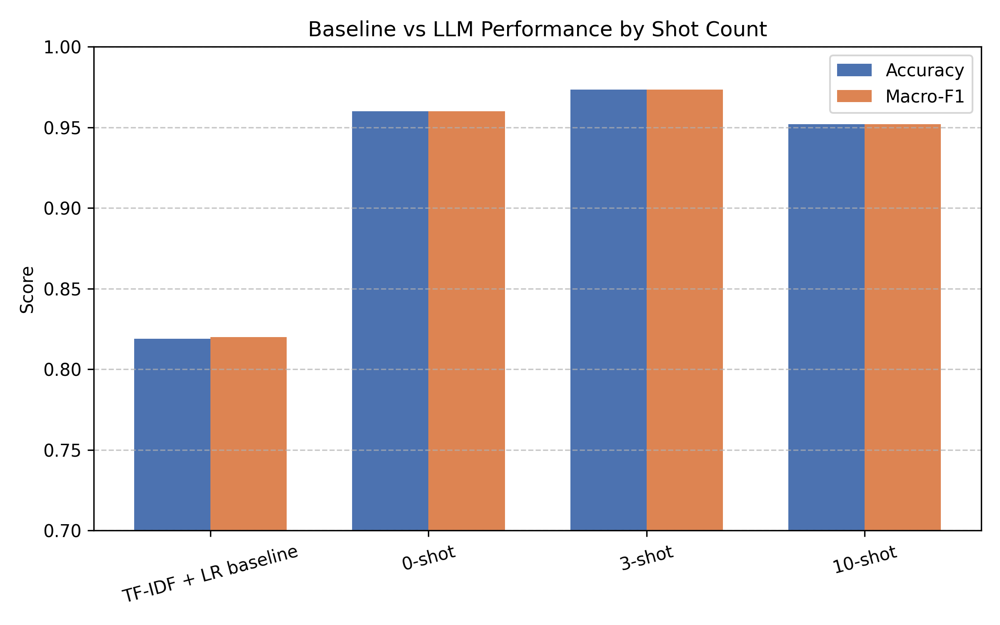
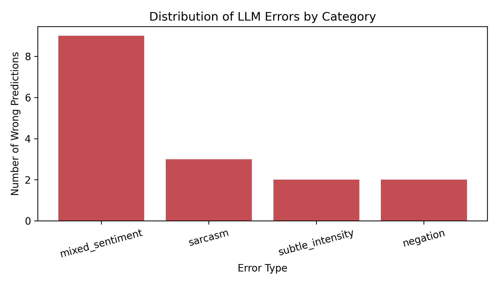
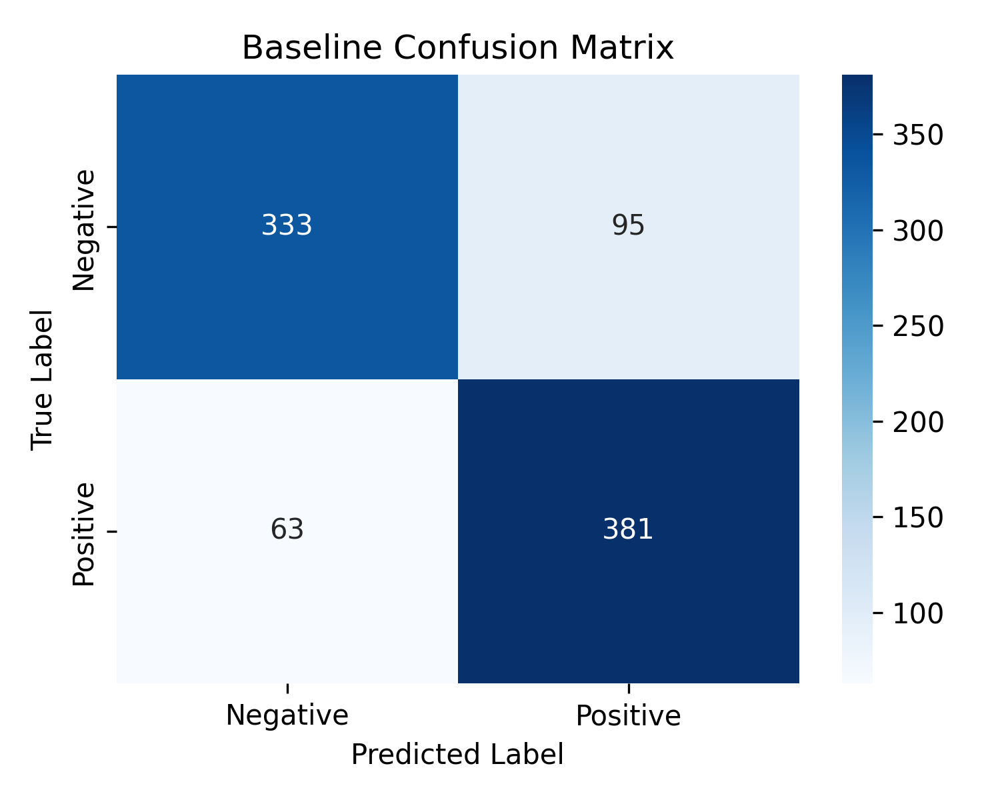

# Few-Shot Prompting for Sentiment Classification on SST-2

## Problem
Does few-shot prompting improve sentiment classification accuracy on SST-2
relative to a TF-IDF + logistic regression baseline, and how does accuracy
change as the number of in-context examples increases from 0 to 3 to 10?

## Data
- **SST-2** (Stanford Sentiment Treebank v2), loaded via
  `load_dataset("nyu-mll/glue", "sst2")`.
- Public benchmark dataset of movie-review sentences.
- Binary labels: 0 = negative, 1 = positive.
- Splits used: `train` (for fitting baseline + few-shot pool),
  `validation` (for evaluation), `test` (reserved, not used in this phase).

## Method
- **Baseline:** TF-IDF vectorizer (unigrams + bigrams, max_features=10000)
  + Logistic Regression (max_iter=1000, random_state=42). Evaluated on the
  full 872-example validation set.
- **LLM Condition:** Google Gemini (`gemini-3.1-flash-lite`). Evaluated on
  the first 150 validation examples (due to free-tier RPD limits). The
  `temperature` was set to 0.0 for deterministic outputs. Few-shot examples
  (k=0, 3, 10) were sampled with balanced classes from the training split
  using a fixed seed (42).

## Results

| Condition | n | Accuracy | Macro-F1 | Parse failures |
|---|---|---|---|---|
| TF-IDF + Logistic Regression (baseline) | 872 | 0.8188 | 0.820 | 0 |
| 0-shot prompt (Gemini 3.1 Flash-Lite) | 150 | 0.9600 | 0.960 | 0 |
| 3-shot prompt (Gemini 3.1 Flash-Lite) | 150 | 0.9733 | 0.973 | 0 |
| 10-shot prompt (Gemini 3.1 Flash-Lite) | 125* | 0.9520 | 0.952 | 0 |

*\*The 10-shot condition completed 125/150 examples before hitting the Gemini free-tier limit of 500 requests per day.*

**Baseline vs LLM:** The zero-shot LLM beats the classical TF-IDF baseline by **+14.1 percentage points** in accuracy and **+14.0 points** in macro-F1. Even the lower bound of the LLM's 95% confidence interval (0.960 ± 3.1% → [0.929, 0.991]) does not overlap the baseline (0.819).

**Shot-count effect:** 0-shot → 3-shot improved accuracy by +1.3 pp, while 0-shot → 10-shot changed it by −0.8 pp. Both differences are well within the ±3% confidence interval for a proportion at n=150. Therefore, this experiment cannot conclude that few-shot examples provide a measurable boost on SST-2.

*Figure 1: Accuracy and Macro-F1 across conditions. The LLM saturates the task at 0-shot.*

*Figure 2: Error categories show that ambiguous/mixed sentiment was the primary failure mode.*

*Figure 3: The baseline confusion matrix shows it makes a balanced number of false positives and false negatives, unlike the LLM which hits a ceiling.*

## Error Analysis
Of 425 valid LLM predictions across the three conditions, only 16 were wrong (3.8%). The dominant error categories were:

| Category | Count | Example |
|---|---|---|
| Mixed sentiment | 9 | *"does paint some memorable images ... , but makhmalbaf keeps her distance from the characters"* (True: positive, Pred: negative) |
| Sarcasm / surface-negative | 3 | *"hilariously inept and ridiculous ."* (True: positive, Pred: negative) |
| Negation | 2 | *"you wo n't like roger , but you will quickly recognize him ."* (True: negative, Pred: positive) |
| Subtle intensity | 2 | *"fresnadillo 's dark and jolting images ... like the nightmare you had a week ago"* (True: positive, Pred: negative) |

**Interpretation:** Four sentences failed at **every single shot count** (k=0, 3, and 10). Adding 3 or 10 in-context examples did not correct these specific errors. The errors are not random; they are concentrated on a fixed subset of inherently ambiguous sentences whose sentiment depends on contrast, irony, or implicit praise/criticism. This explains why the accuracy differences across *k* were within noise: few-shot prompting does not fix systemic failure modes on hard examples.

## Limitations
- **Provider history:** Pipeline development initially used Groq (`gpt-oss-20b`), but the daily request limit (1,000 RPD) was exhausted, and the model's hidden reasoning tokens made it unreliable for short prompts. The experiment was moved to Gemini. Only the `classify_with_retry` function changed between providers, demonstrating the pipeline is provider-agnostic.
- **Evaluation subset:** The LLM conditions were evaluated on a 150-example subset (and 125 for k=10 due to quota limits), while the baseline was evaluated on 872. Both sets are drawn from the same distribution, but sample size variances apply.
- **Ceiling effect:** SST-2 is near-saturated by 2026 frontier models (human agreement is ~97%). The zero-shot accuracy of 0.96 leaves only 4 points of headroom, which is smaller than the noise floor at n=150. A harder benchmark (e.g., SST-5 fine-grained or cross-domain sentiment) would be required to detect a true shot-count effect.

## Privacy
All data used is the public SST-2 benchmark. No private or institutional records are used or uploaded to any external service. API keys are stored locally in a `.env` file excluded by `.gitignore`.

## Reproducibility
- `baseline_experiment.ipynb`: Contains the TF-IDF + LR baseline.
- `prompting_experiment.ipynb`: Contains the Gemini API evaluation loop, prompt builder, and error analysis.
- `requirements.txt`: Pinned dependencies for the environment.
- Results are exported to the `results/` folder for independent verification.